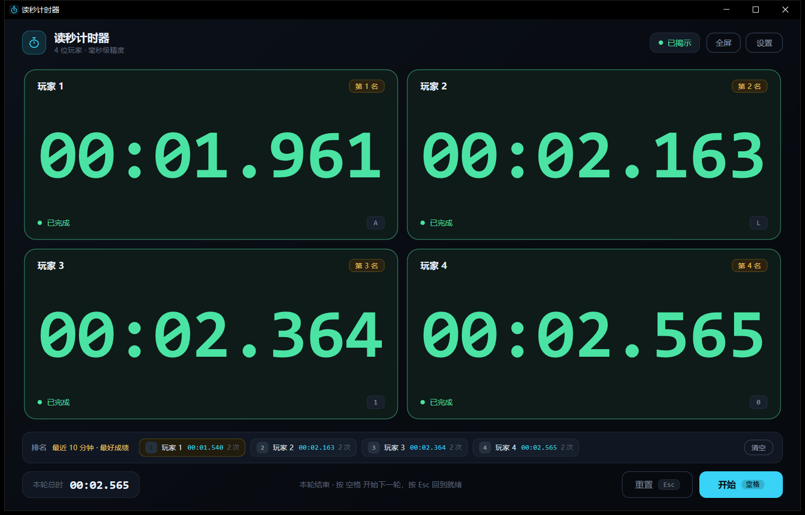
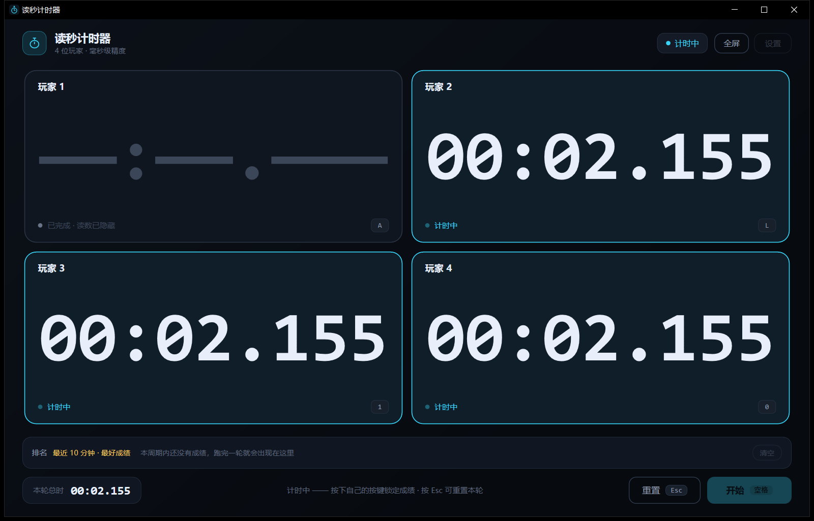
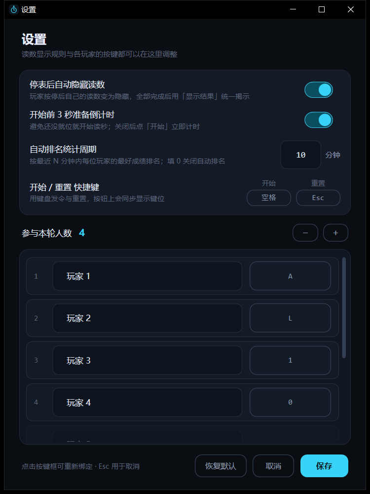
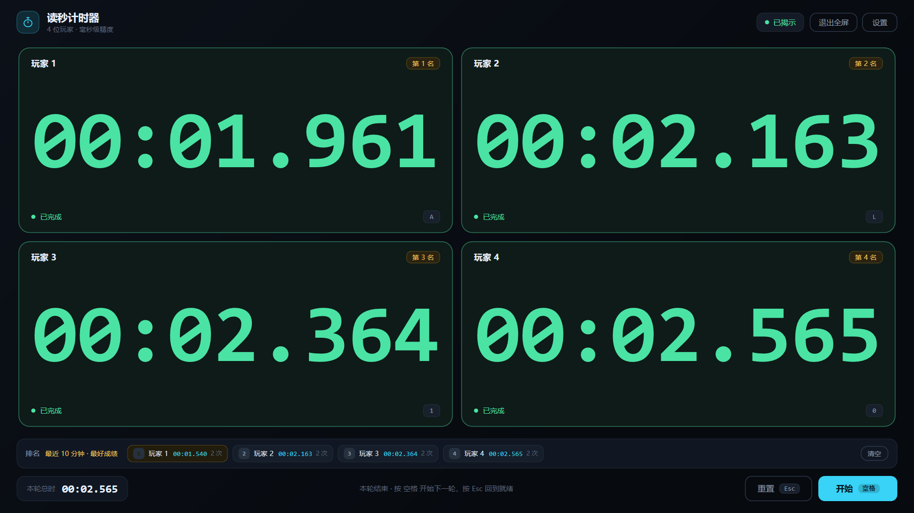

# 读秒计时器（SplitTimer）

多人同场读秒计时工具。每位玩家有自己的按键，按下即锁定成绩，读数自动隐藏；等所有玩家都按完，再用「显示结果」统一揭示成绩与名次。

计时显示到毫秒（`mm:ss.fff`），底层用 `Stopwatch`（QPC 高精度计数器），UI 只是按帧采样，成绩在按键触发的瞬间取值，不受刷新间隔影响。



## 核心交互

1. **发令**：按开始键（默认 `空格`）或点「开始」。默认有 3 秒准备倒计时，倒计时结束才开始读秒。
2. **停表**：每位玩家按自己的按键（默认 `A` / `L` / `1` / `0` …），该玩家的读数立刻锁定并自动隐藏。
3. **揭示**：所有玩家都按完后，底部出现「显示结果」，点击后同时显示所有人的成绩与名次。
4. **下一轮**：按重置键（默认 `Esc`）或点「重置」回到就绪，也可以直接再按一次开始键。

键盘需要窗口处于激活状态；窗口失焦时底部会提示，按键不会响应。

「开始」与「重置」的按键都能在设置里改成任意键，按钮上内嵌当前键位，底部提示也会同步（例如「按 G 开始新一轮」）。默认键位：

| 操作 | 默认按键 | 说明 |
| --- | --- | --- |
| 开始 | `空格` | 就绪或已结束状态下发令开始新一轮 |
| 重置 | `Esc` | 倒计时 / 计时中 / 已结束都能按，一键回就绪（全屏时先退出全屏） |

每张玩家卡片用一个状态表示，颜色与文案固定，投影时一眼能看出谁还在跑：

| 状态 | 表现 |
| --- | --- |
| 等待开始 | 灰色读数 `00:00.000` |
| 计时中 | 青色边框 + 呼吸状态点，读数实时滚动 |
| 已完成（隐藏） | 读数变成 `——:——.———`，状态文字「已完成 · 读数已隐藏」 |
| 已完成（揭示） | 绿色读数 + 金色名次徽章 |



## 按时间周期排名

名次不再只是「这一轮谁先按停」，而是**最近一段时间内谁最快**：

- 设置里的「自动排名统计周期」填分钟数（0–1440），程序只取该周期内每位玩家的**最好成绩**排序，同成绩并列同名次。
- 每轮成绩揭示后写入榜单（带时间戳），跨轮自动累计；卡片右上角徽章与底部「排名」条都来自这份结果。
- 周期填 **0**（或留空）即**关闭自动排名**：不写榜单、不显示任何名次，只保留本轮读数。
- 底部「清空」可重置当前周期的历史成绩（会二次确认）。

榜单保存在 `%AppData%\SplitTimer\leaderboard.json`，关掉程序再打开仍能续上窗口内的成绩。

## 设置

点右上角「设置」进入，运行中会自动禁用（避免比赛途中改配置）。

- **停表后自动隐藏读数**：关闭后，玩家按停就直接显示成绩与名次，不再需要「显示结果」。
- **开始前 3 秒准备倒计时**：关闭后点「开始」立即读秒。
- **自动排名统计周期**：见上节，填 0 关闭。
- **参与本轮人数**：1 ~ 8 人，卡片按人数自动排布（1 列 / 2 列 / 3 列 / 4 列）。
- **开始 / 重置 快捷键**：点「开始」或「重置」下面的按键框，按下想绑定的键即可（`Esc` 取消捕获，用「恢复默认」可把 `Esc` 绑回重置）。保存时会校验：两者不能相同，也不能与在场玩家的停表键撞车。
- **每位玩家的名字与按键**：点击右侧按键框，按下想绑定的键即可（`Esc` 取消）。保存时会校验重复按键与未绑定按键。

配置写在 `%AppData%\SplitTimer\settings.json`，手动改坏（键名非法、人数越界、周期越界）也能自动回退到安全值。



## 全屏

顶栏提供「全屏」与「退出全屏」两个按钮（互斥显示），也可以直接用 `F11` 切换、`Esc` 退出。全屏时隐藏标题栏，卡片与读数按窗口等比放大，适合投影。



## 构建与发布

```bash
dotnet build SplitTimer.slnx -c Debug -nr:false

# 单文件自包含 exe（无需装 .NET）
dotnet publish src/SplitTimer/SplitTimer.csproj -c Release -r win-x64 \
  --self-contained true -p:PublishSingleFile=true \
  -p:IncludeNativeLibrariesForSelfExtract=true \
  -p:EnableCompressionInSingleFile=true -p:DebugType=none -o dist
```

产物：`dist/SplitTimer.exe`（约 62 MB，Windows x64，自带运行时）。

版本号写在 `src/SplitTimer/SplitTimer.csproj` 的 `<Version>`。**改完版本号推送到 GitHub 后，Actions 会自动构建、打 `vX.Y.Z` 标签并发布 Release**，历史版本都留在 Releases 页面。

## 介绍页与下载

- 介绍页：<https://capybarahz.github.io/SplitTimer/>
- 最新版下载：`https://github.com/CapybaraHZ/SplitTimer/releases/latest/download/SplitTimer.exe`
- 历史版本：<https://github.com/CapybaraHZ/SplitTimer/releases>

Pages 用 legacy 方式直接从 `main` 分支的 `/docs` 目录发布，工作流只负责构建并发布 Release，不碰站点产物。页面上的下载按钮指向 Release 资产（`releases/latest/download/SplitTimer.exe`），版本列表则在浏览器端读 GitHub Releases API，自动列出全部历史版本并逐条给出真实资产链接与体积。

## 目录结构

```
SplitTimer.slnx
.github/workflows/release.yml   推送即构建 + 发布 Release（自动版本）
src/SplitTimer/
  MainWindow.xaml(.cs)      主界面：卡片、倒计时、按键分发、排名条、一轮的状态机
  SettingsWindow.xaml(.cs)  设置：开关、人数、排名周期、开始/重置快捷键、逐玩家改键
  Models/Player.cs          玩家数据（只持状态，显示文案由主窗口统一刷新）
  Models/RankEntry.cs       排名条的一条展示数据
  Models/KeyNames.cs        Key 枚举 ↔ 界面可读名字
  Services/AppSettings.cs   配置模型 + Normalize 兜底
  Services/SettingsStore.cs 读写 %AppData%\SplitTimer\settings.json
  Services/Leaderboard.cs   成绩记录 + 按周期排名 + leaderboard.json 落盘
  Services/TimeFormat.cs    mm:ss.fff 格式化（毫秒截断）
  Services/ThemeHelper.cs   深色标题栏 / 圆角窗口
  Styles/Theme.xaml         配色、按钮、开关、滚动条样式
  app.ico                   应用图标
tools/keysim/               端到端测试用的按键注入 + 截图小工具（不参与发布）
docs/index.html             介绍页（GitHub Pages）
docs/screenshots/           界面截图
```

## 实现要点

- **计时精度**：`Stopwatch.Elapsed` 是唯一真值，`DispatcherTimer`（16 ms）只负责把当帧读数刷到界面；停表成绩在 KeyDown 里直接取，所以刷新频率不影响精度。
- **一次按键只停一次**：`e.IsRepeat` 之外还用 `_heldKeys` 集合挡住按住不放产生的自动重复，窗口失焦时清空。
- **隐藏规则只有一个入口**：`RefreshAll()` 里按 `_revealed || !AutoHideResults` 统一决定显示内容，避免各玩家卡片各算各的。
- **成绩入榜时机 = 揭示时机**：只有成绩真的公开了（自动隐藏关闭，或点了「显示结果」）才写入榜单，防止通过名次反推隐藏的读数。
- **排名按玩家下标聚合**：改名字不会拆成两个榜单条目；周期为 0 时 `Snapshot` 直接返回空，调用方不需要额外判断。
- **快捷键优先级**：重置键在非就绪状态下最先判断，其次是玩家停表键，最后才是开始键——所以同一个键被配置到两处时行为可预测；`Normalize()` 也会把与重置键撞车的停表键换回默认值，避免那位玩家永远停不了表。
- **输入法**：主窗口关闭 IME（`InputMethod.IsInputMethodEnabled="False"`），否则中文输入法会吞掉字母按键，玩家按停无效。
